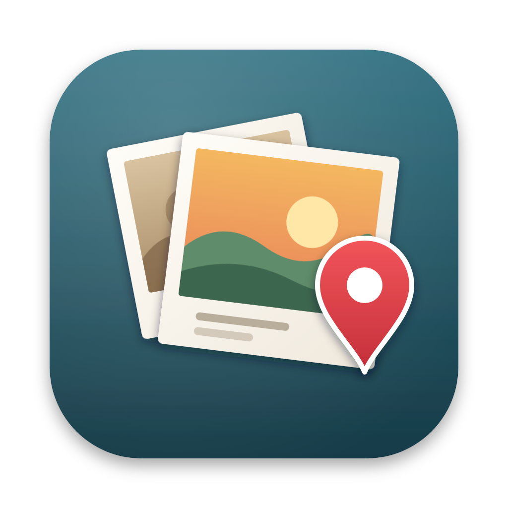

<p align="center">
  
</p>

<h1 align="center">EXIF Data Manager</h1>

<p align="center">
  Eine schlichte macOS-App, um eingescannte analoge Fotos mit Datum, Ort und Personen zu versehen –<br>
  direkt in den Bilddateien, in offenen Standards.
</p>

<p align="center">
  <a href="https://github.com/zulu101/EXIFdatamanager/actions/workflows/build.yml"></a>
  <a href="LICENSE"></a>
  
</p>

<p align="center">
  <a href="README.md">English</a> · <b>Deutsch</b>
</p>

---

Alte Familienfotos haben meist keinerlei Angaben. **EXIF Data Manager** hilft dabei festzuhalten, *wann*
ein Foto entstanden ist, *wo* und *wer* darauf zu sehen ist – damit dieses Wissen in den nächsten
Jahrzehnten nicht verloren geht.

Alle Angaben werden **direkt in die Bilddateien** geschrieben, in etablierten Standards (EXIF, IPTC und
XMP). So können sie auch Apple Fotos, Lightroom, digiKam oder künftige Programme lesen – unabhängig von
dieser App.


## Funktionen

- **Aufnahmedatum mit Genauigkeit** – „nur Jahr“, „Monat & Jahr“, „genauer Tag“ oder „Tag & Uhrzeit“.
  Ideal, wenn man nur „Sommer 1978“ weiß.
- **Aufnahmeort** – Ortssuche, Klick in die Karte, automatische Ermittlung von Stadt/Region/Land, eigene
  Ortsbezeichnung (z. B. „Haus der Großeltern“) und eine Liste zuletzt verwendeter Orte.
- **Personen** – Namen werden gemerkt und beim nächsten Foto vorgeschlagen.
- **Gesichter markieren** – Rahmen mit der Maus aufziehen und benennen, oder Gesichter automatisch
  erkennen lassen (lokal auf dem Mac, mit Apples Vision-Framework). *Experimentell:* Namensvorschläge
  anhand bereits benannter Gesichter.
- **Beschreibung und Schlagwörter.**
- **Stapelbearbeitung** – mehrere Fotos auswählen (⇧/⌘-Klick) und Datum, Ort, Personen usw. auf einmal
  setzen – ideal für einen ganzen Film.
- **Fotos drehen** um 90° nach links/rechts (⌘L / ⌘R) – verlustfrei über die EXIF-Ausrichtung. Markierte
  Gesichter drehen sich mit.
- **„Vom vorherigen Foto übernehmen“** für Bildserien.
- **Dateien anhand der Metadaten umbenennen** (⇧⌘R) – z. B. `1985-07-14_00-00_Sylt.jpg`, mit frei
  wählbarem Muster (Datum, Ort, Stadt, Land, Personen, Beschreibung, Originalname, Zähler) und
  Live-Vorschau. Das Datum hat immer die Form `JJJJ-MM-TT_HH-MM`; Unbekanntes wird mit `00` aufgefüllt
  (`1985-07-00_00-00` = nur Monat und Jahr bekannt), sodass die Dateien in jedem Datei-Explorer
  chronologisch sortiert sind. Der ursprüngliche Dateiname bleibt in der Datei erhalten,
  Sicherungskopien werden mit umbenannt.
- **Erstelldatum der Datei** optional auf das Aufnahmedatum setzen – damit sortiert auch der Finder
  nach „Erstellt am“ richtig.
- **Sicher speichern**
  - Die Bilddaten werden nie neu komprimiert, nur die Metadaten werden ersetzt.
  - Bevor das Original ersetzt wird, liest die App die neue Datei vollständig ein und vergleicht alle
    Angaben. Fehlt etwas, bleibt das Original unverändert.
  - Optionale Sicherungskopie vor dem ersten Speichern (standardmäßig an). Sicherungskopien landen
    automatisch im Papierkorb – beim Beenden, nach 7 oder 30 Tagen (Standard) oder nie.
- Oberfläche auf **Deutsch und Englisch**.
- Unterstützte Formate: JPEG, TIFF, PNG (HEIC je nach macOS-Version).

## Installation

### Herunterladen

1. Unter [Releases](https://github.com/zulu101/EXIFdatamanager/releases) die neueste
   **EXIF Data Manager (macOS).zip** herunterladen und entpacken.
2. **EXIF Data Manager.app** in den Ordner *Programme* ziehen.
3. Die App ist nicht von Apple notarisiert. Beim ersten Start blockiert macOS sie daher:
   *Systemeinstellungen → Datenschutz & Sicherheit* öffnen, nach unten scrollen und **Dennoch öffnen**
   klicken.

### Selbst bauen

Voraussetzung: macOS 14 (Sonoma) oder neuer und Xcode (oder die Command Line Tools).

```bash
git clone https://github.com/zulu101/EXIFdatamanager.git
```

```bash
cd EXIFdatamanager && ./scripts/build-app.sh
```

Die App liegt danach unter `build/EXIF Data Manager.app`.

## Bedienung

1. Fotos oder ganze Ordner ins Fenster ziehen (oder ⌘O).
2. Foto auswählen und rechts Datum, Ort, Personen und Beschreibung eintragen.
3. Mit ⌘↑ / ⌘↓ zum vorherigen/nächsten Foto wechseln.
4. **⌘S** schreibt alle Änderungen in die Dateien. Ein orangefarbener Punkt in der Liste zeigt
   ungespeicherte Änderungen, ein grüner Haken: Datum und Ort sind eingetragen.

## Wo landen die Daten in der Datei?

| Angabe | Gespeichert in |
| --- | --- |
| Aufnahmedatum | EXIF `DateTimeOriginal` (immer vollständig, fehlende Teile = 1. Januar bzw. 00:00 Uhr) und XMP `photoshop:DateCreated` (mit echter Genauigkeit, z. B. `1985` oder `1985-07`) |
| Koordinaten | EXIF GPS (`GPSLatitude`/`GPSLongitude` + Ref) |
| Ortsbezeichnung | XMP `Iptc4xmpCore:Location` (IPTC Sublocation) |
| Stadt / Region / Land | XMP `photoshop:City` / `photoshop:State` / `photoshop:Country` |
| Personen | XMP `Iptc4xmpExt:PersonInImage` **und** als Schlagwort in `dc:subject` |
| Gesichtsrahmen | XMP `mwg-rs:Regions` (Metadata Working Group, Typ „Face“) **und** `Iptc4xmpExt:ImageRegion` (IPTC, Inhaltstyp „human“, mit „Person im Bild“) |
| Schlagwörter | XMP `dc:subject` |
| Beschreibung | EXIF `ImageDescription` / XMP `dc:description` |
| Ursprünglicher Dateiname (vor dem Umbenennen) | XMP `xmpMM:PreservedFileName` |
| Drehung | EXIF/TIFF `Orientation` (die Bilddaten bleiben unverändert) |

Personen werden zusätzlich als Schlagwort gespeichert, weil viele Programme (u. a. Apple Fotos) das
IPTC-Feld „Person im Bild“ nicht anzeigen, Schlagwörter aber schon.

### Gesichter

Rahmen und Namen werden in **zwei offenen Standards** gespeichert, damit möglichst viele Programme sie
lesen können: MWG-Regionen (z. B. Lightroom Classic, digiKam, ExifTool) und IPTC-Bildregionen
(offizieller IPTC-Standard seit 2019). Die Koordinaten beziehen sich – wie vom MWG-Standard verlangt – auf
das gespeicherte, ungedrehte Bild; gedrehte Fotos werden korrekt umgerechnet. Regionen anderer Art aus
anderen Programmen (z. B. Haustiere) bleiben erhalten. Jeder Build prüft die geschriebenen Regionen mit
[ExifTool](https://exiftool.org).

Die automatische Erkennung findet nur, *wo* Gesichter sind. Für Namensvorschläge vergleicht die App
Bildausschnitte mit bereits benannten Gesichtern der geladenen Fotos. Diese Vergleichsdaten existieren
nur im Arbeitsspeicher und werden **nie** gespeichert – in der Datei landen ausschließlich Rahmen und
Namen. Apple Fotos zeigt die Rahmen nicht an, übernimmt aber die Namen als Schlagwörter.

**Einschränkung:** In PNG-Dateien werden keine Gesichtsrahmen gespeichert, weil Apples ImageIO die
verschachtelten XMP-Strukturen dort nicht zuverlässig geschrieben hat. Die Namen werden trotzdem
gespeichert.

## Tipps zur Langzeit-Archivierung

- Die Beschreibung ist das wertvollste Feld: Anlass, wer wo steht, kleine Geschichten.
- Wenn das Datum unsicher ist, lieber „nur Jahr“ wählen und z. B. „ca. 1975“ in die Beschreibung
  schreiben.
- Weiterhin regelmäßig Backups machen (z. B. Time Machine und eine Kopie außer Haus).

## Sprache

Die App folgt standardmäßig der Sprache von macOS. Umstellen lässt sie sich in den Einstellungen der App
(⌘,) unter *Sprache* oder – wie bei jeder Mac-App – unter
*Systemeinstellungen → Allgemein → Sprache & Region → Apps*.

## Entwicklung

```
Sources/ExifCore/          Metadaten lesen/schreiben (ImageIO), ohne Oberfläche, getestet
Sources/ExifDataManager/   SwiftUI-App
Tests/ExifCoreTests/       Tests inkl. Schreib-/Lese-Durchlauf mit echten JPEG/TIFF/PNG
Resources/                 App-Icon und Übersetzungen (Localization/<Sprache>.lproj)
scripts/                   Build-Skript und CI-Prüfungen
```

- Projekt in Xcode öffnen mit `open Package.swift` oder mit `swift run` starten. Tests: `swift test`.
- Beim Start aus Xcode bzw. per `swift run` ist die Oberfläche immer deutsch; die Übersetzungen werden
  erst von `scripts/build-app.sh` ins App-Bundle kopiert.
- Die deutschen Texte im Code sind zugleich die Schlüssel für Übersetzungen. Die englischen
  Übersetzungen liegen in `Resources/Localization/en.lproj/Localizable.strings`;
  `scripts/check_localization.py` (läuft auch im CI) prüft, dass jeder Text übersetzt ist.
- Releases: Ein Tag wie `v1.0.0` baut die App und veröffentlicht sie unter *Releases*.

## Lizenz

[MIT](LICENSE)
