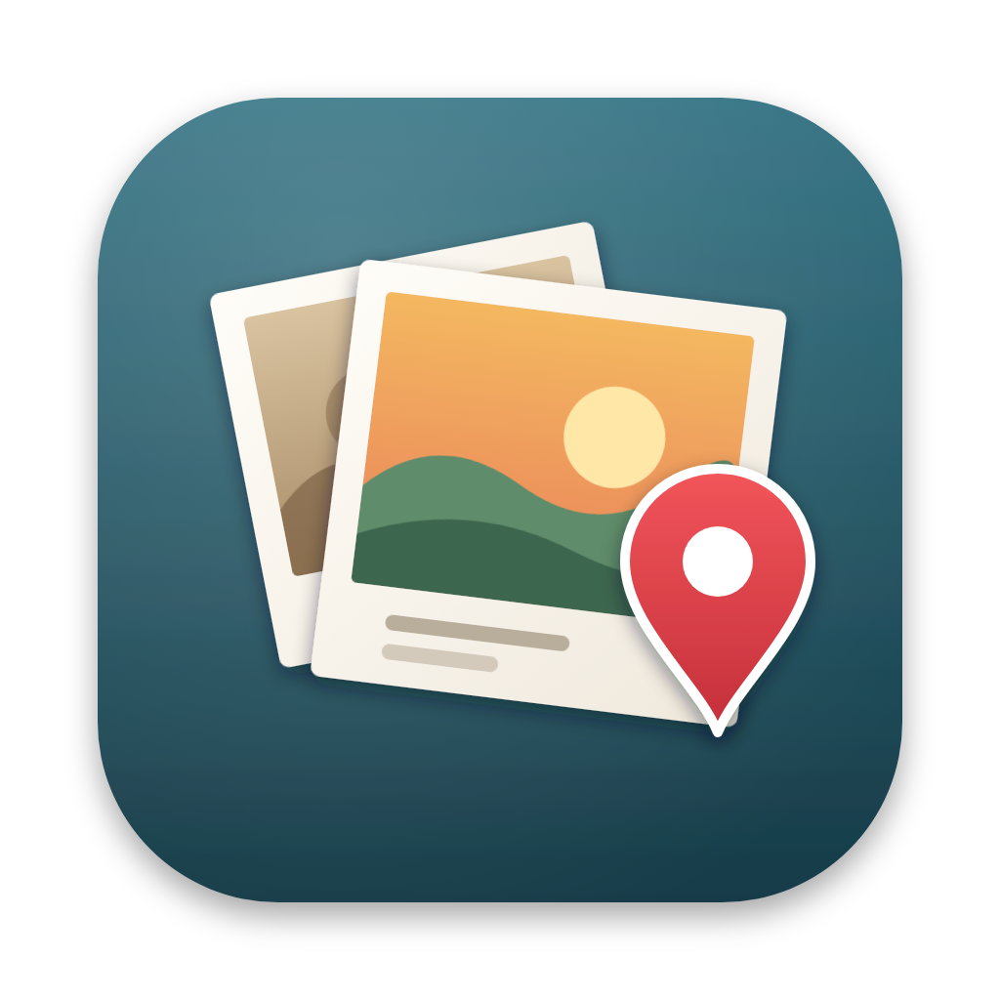

<p align="center">
  
</p>

<h1 align="center">EXIF Data Manager</h1>

<p align="center">
  A simple macOS app for adding dates, places and people to scanned analog photos –<br>
  stored directly in the image files, using open standards.
</p>

<p align="center">
  <a href="https://github.com/zulu101/EXIFdatamanager/actions/workflows/build.yml"></a>
  <a href="LICENSE"></a>
  
</p>

<p align="center">
  <b>English</b> · <a href="README.de.md">Deutsch</a>
</p>

---

Old family photos usually come without any information attached. **EXIF Data Manager** helps you record
*when* a photo was taken, *where*, and *who* is in it – so this knowledge isn’t lost over the coming
decades.

All information is written **directly into the image files** using established standards (EXIF, IPTC and
XMP). Apple Photos, Lightroom, digiKam and future software can read it – independently of this app.

<!-- Screenshots: add images to docs/screenshots/ and uncomment the lines below.
<p align="center">
  
</p>
<p align="center">
  
  
</p>
-->

## Features

- **Date taken with precision** – “year only”, “month & year”, “exact day” or “day & time”. Perfect when
  all you know is “summer 1978”.
- **Location** – search for places, click on the map, automatic city/region/country lookup, custom place
  names (e.g. “Grandparents’ house”) and a list of recently used places.
- **People** – names are remembered and suggested for the next photo.
- **Mark faces** – drag a frame around a face and name it, or let faces be detected automatically
  (locally on your Mac with Apple’s Vision framework). *Experimental:* name suggestions based on faces
  you have already named.
- **Description and keywords.**
- **Batch editing** – select several photos (⇧/⌘-click) and set date, place, people, etc. at once – ideal
  for a whole film roll.
- **“Copy from previous photo”** for photo series.
- **Rename files from metadata** (⌘R) – e.g. `1985-07-14_00-00_Sylt.jpg`, with a freely configurable
  pattern (date, place, city, country, people, description, original name, counter) and a live preview.
  The date always has the form `YYYY-MM-DD_HH-MM`; unknown parts are filled with `00`
  (`1985-07-00_00-00` = only month and year known), so files sort chronologically in any file browser.
  The original file name is kept inside the file, and backup copies are renamed too.
- **Set the file’s creation date** to the date taken (optional), so the Finder also sorts by
  “Date Created”.
- **Safe saving**
  - Image data is never re-compressed – only the metadata is replaced.
  - Before the original is replaced, the app re-reads the new file and compares every detail. If anything
    is missing, the original stays untouched.
  - Optional backup copy before the first save (on by default).
- **German and English** user interface.
- Supported formats: JPEG, TIFF, PNG (HEIC depending on the macOS version).

## Installation

### Download

1. Download the latest **EXIF Data Manager (macOS).zip** from
   [Releases](https://github.com/zulu101/EXIFdatamanager/releases) and unzip it.
2. Move **EXIF Data Manager.app** to your *Applications* folder.
3. The app is not notarized by Apple. On first launch macOS will block it:
   open *System Settings → Privacy & Security*, scroll down and click **Open Anyway**.

### Build it yourself

Requirements: macOS 14 (Sonoma) or later and Xcode (or the Command Line Tools).

```bash
git clone https://github.com/zulu101/EXIFdatamanager.git
```

```bash
cd EXIFdatamanager && ./scripts/build-app.sh
```

The app is created at `build/EXIF Data Manager.app`.

## Usage

1. Drag photos or entire folders into the window (or press ⌘O).
2. Select a photo and enter the date, place, people and description on the right.
3. Use ⌘↑ / ⌘↓ to move to the previous/next photo.
4. **⌘S** writes all changes to the files. An orange dot in the list marks unsaved changes; a green
   checkmark means date and place are filled in.

## Where is the data stored?

| Detail | Stored in |
| --- | --- |
| Date taken | EXIF `DateTimeOriginal` (always complete; missing parts become January 1 / 00:00) and XMP `photoshop:DateCreated` (with the real precision, e.g. `1985` or `1985-07`) |
| Coordinates | EXIF GPS (`GPSLatitude`/`GPSLongitude` + ref) |
| Place name | XMP `Iptc4xmpCore:Location` (IPTC Sublocation) |
| City / region / country | XMP `photoshop:City` / `photoshop:State` / `photoshop:Country` |
| People | XMP `Iptc4xmpExt:PersonInImage` **and** as keywords in `dc:subject` |
| Face frames | XMP `mwg-rs:Regions` (Metadata Working Group, type “Face”) **and** `Iptc4xmpExt:ImageRegion` (IPTC, content type “human”, with “Person shown”) |
| Keywords | XMP `dc:subject` |
| Description | EXIF `ImageDescription` / XMP `dc:description` |
| Original file name (before renaming) | XMP `xmpMM:PreservedFileName` |

People are also stored as keywords because many apps (including Apple Photos) don’t show the IPTC
“Person shown” field, but they do show keywords.

### Faces

Frames and names are stored in **two open standards** so that as many apps as possible can read them:
MWG regions (e.g. Lightroom Classic, digiKam, ExifTool) and IPTC image regions (official IPTC standard
since 2019). As required by the MWG standard, coordinates refer to the stored, unrotated image; rotated
photos are converted correctly. Regions of other kinds written by other apps (e.g. pets) are preserved.
Every build verifies the written regions with [ExifTool](https://exiftool.org).

Automatic detection only finds *where* faces are. For name suggestions, the app compares image crops with
faces you have already named in the loaded photos. This comparison data only exists in memory and is
**never** stored – only frames and names end up in the files. Apple Photos does not show the frames, but
imports the names as keywords.

**Limitation:** face frames are not stored in PNG files, because Apple’s ImageIO did not write the nested
XMP structures reliably there. Names are still stored.

## Tips for long-term archiving

- The description is the most valuable field: the occasion, who is standing where, little stories.
- If you’re unsure about the date, choose “year only” and write e.g. “approx. 1975” in the description.
- Keep making backups (e.g. Time Machine plus an off-site copy).

## Language

The app follows the macOS language by default. You can change it in the app settings (⌘,) under
*Language*, or – like any Mac app – in *System Settings → General → Language & Region → Applications*.

## Development

```
Sources/ExifCore/          Reading/writing metadata (ImageIO), no UI, unit-tested
Sources/ExifDataManager/   SwiftUI app
Tests/ExifCoreTests/       Tests incl. write/read round trips with real JPEG/TIFF/PNG files
Resources/                 App icon and translations (Localization/<lang>.lproj)
scripts/                   Build script and CI checks
```

- Open the project in Xcode with `open Package.swift`, or run it with `swift run`. Tests: `swift test`.
- When launched from Xcode or with `swift run`, the UI is always German; translations are only copied into
  the app bundle by `scripts/build-app.sh`.
- German texts in the source code double as localization keys. English translations live in
  `Resources/Localization/en.lproj/Localizable.strings`; `scripts/check_localization.py` (also run in CI)
  makes sure every text has a translation.
- Releases: pushing a tag like `v1.0.0` builds the app and publishes it on the Releases page.

## License

[MIT](LICENSE)
